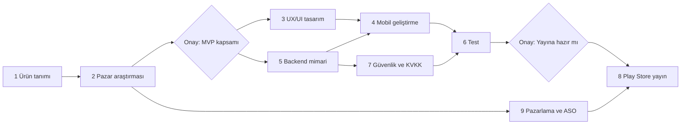

# Murevet: Fikirden Google Play'e Ajan Ekibi ve Süreç

Bu doküman, Murevet uygulamasını fikirden Google Play yayınına götürecek ajan ekibini ve aralarındaki iş akışını anlatır. Koordinatör Claude'dur: aşamaları sıraya koyar, ajanlara iş verir, çıktıları birbirine aktarır ve onay gereken her noktada sana (Can) sorar.

## Ekip

| # | Ajan | Ne yapar | Ana çıktı |
|---|------|----------|-----------|
| 1 | `urun-stratejisti` | Fikri netleştirir, persona, MVP kapsamı, KPI, gelir modeli | `docs/01-urun/urun-tanimi.md` |
| 2 | `pazar-arastirmaci` | Rakipler, pazar büyüklüğü, Play yorumları, anahtar kelimeler | `docs/02-pazar/pazar-raporu.md` |
| 3 | `ux-ui-tasarimci` | Akışlar, ekranlar, wireframe, tasarım sistemi | `docs/03-tasarim/` |
| 4 | `mobil-gelistirici` | Android uygulaması (varsayılan Flutter), imzalı AAB | Kod + `docs/04-mobil/` |
| 5 | `backend-gelistirici` | Mimari, veri modeli, API, medya, bildirim | Kod + `docs/05-backend/` |
| 6 | `qa-test` | Test planı, otomatik/manuel test, sürüm raporu | `docs/06-test/` |
| 7 | `guvenlik-kvkk` | Güvenlik, KVKK, gizlilik politikası, Play Veri Güvenliği | `docs/07-guvenlik/` |
| 8 | `play-store-yayin` | Play Console, mağaza listesi, test kanalları, yayın | `docs/08-yayin/` |
| 9 | `pazarlama` | ASO, lansman, içerik, iş birlikleri, büyüme | `docs/09-pazarlama/` |

## Akış

## Aşamalar ve onay kapıları

| Aşama | Ajanlar | Bitiş kriteri | Senin onayın |
|-------|---------|---------------|--------------|
| 0. Fikir | ürün, pazar | Ürün tanımı + pazar raporu | **Kapı 1:** MVP kapsamı ve gelir modeli |
| 1. Tasarım ve mimari | UX/UI, backend, güvenlik | Ekranlar, veri modeli, API sözleşmesi, veri envanteri | **Kapı 2:** Tasarım ve teknoloji seçimi |
| 2. Geliştirme | mobil, backend (paralel), QA her özellikte | MVP özellikleri tamam, testler geçiyor | Her PR'ı inceleyip birleştirme |
| 3. Kapalı test | QA, yayın, pazarlama (testçi bulma) | Kapalı test süresi doldu, kritik hata yok | **Kapı 3:** Üretime çıkış |
| 4. Yayın | yayın, pazarlama | Mağazada yayında, aşamalı dağıtım | Her Play Console gönderimi |
| 5. Büyüme | pazarlama, ürün, QA | Lansman sonrası KPI'lar izleniyor | Sonraki sürüm kapsamı |

## Çalışma kuralları
- Her ajan çıktısını `docs/` altındaki kendi klasörüne yazar; bir sonraki ajan oradan okur.
- Varsayımlar `VARSAYIM:`, tahminler `TAHMİN:` etiketiyle işaretlenir.
- Kod değişikliği dal + pull request ile yapılır; ana dala doğrudan yazılmaz.
- Geri alınamayan adımlar (Play Console gönderimi, üretim ortamı değişikliği, dışarıya gönderilen mesaj, ödeme) sadece senin açık onayınla yapılır.
- Hukuki metinler taslaktır; yayından önce bir hukukçuya gösterilmelidir.

## Kurulum
Ajanlar Claude Code alt ajan formatındadır. Repo oluşturulduğunda `.claude/agents/` klasörü repo köküne kopyalanır; Claude Code bunları otomatik tanır ve koordinatör ihtiyaç duyduğunda çağırır.

## Varsayımlar (onayını bekleyenler)
1. VARSAYIM: Mobil teknoloji **Flutter**. Sadece Android hedefleniyorsa Kotlin + Jetpack Compose da uygun; ileride iOS da istenirse Flutter avantajlı.
2. VARSAYIM: Backend için başlangıçta yönetilen servis (**Firebase** veya **Supabase**).
3. VARSAYIM: Öncelikli pazar **Türkiye**, arayüz Türkçe (+ İngilizce).
4. VARSAYIM: Google Play geliştirici hesabı henüz yok ve **bireysel** hesap açılacak. Bu durumda yeni hesaplarda kapalı test zorunluluğu var (testçi sayısı ve süre kuralını yayın ajanı güncel dokümandan doğrulayacak). Kurumsal hesap bu zorunluluktan muaftır.
